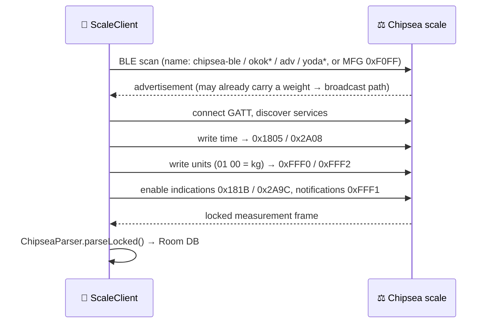

<div align="center">

# ⚖️ Журнал весов · Scale Journal

**A small, focused Android app that talks directly to a cheap Chipsea / OKOK Bluetooth bathroom scale and keeps a history of your weight on your phone. No vendor app or account needed.**

-3DDC84?logo=android&logoColor=white)


</div>

---

## ✨ Features

- 📡 **Scan and connect.** The app finds Chipsea/OKOK-family scales by name or by their `0xF0FF` manufacturer data.
- 🔒 **Locked readings.** Weight comes from the standard Body Composition characteristic, plus **impedance** when the scale reports it.
- 📻 **Broadcast mode.** Scales that only advertise also work: a reading is accepted after 3 identical weights in a row.
- 🕒 **Time sync and units.** The app writes the current time to the scale and switches it to kg.
- 📈 **History and trends.** Readings are grouped by day, shown on a trend chart, and can be deleted with a swipe or added by hand.
- 🧮 **BMI.** BMI is calculated from your profile.
- 🪵 **Built-in log.** You can view the debug log in the app and upload it to GitHub with one tap.
- 🔄 **Self-update.** The app checks GitHub Releases and installs the new APK.
- 🌐 **Unit decoding.** Readings in kg, jin (斤), lb and st:lb are all converted to kg.

## 📱 Screens

| Tab | What it does |
|-----|--------------|
| **Весы** (Scale) | Radar-style scanning animation, live connection status, the result of the latest measurement |
| **Мой вес** (My weight) | Trend chart, day-grouped history, swipe to delete, manual entry |
| **Профиль** (Profile) | Height and other profile data used for BMI, log tools, update check |

## 🔬 How it talks to the scale



### GATT map

| Service | Characteristic | Role |
|---------|----------------|------|
| `0x181B` Body Composition | `0x2A9C` | **Locked measurement** (indications). Required. |
| `0x1805` Current Time | `0x2A08` | 7-byte date/time write |
| `0xFFF0` Vendor UART | `0xFFF2` TX | Config commands, e.g. set units |
| `0xFFF0` Vendor UART | `0xFFF1` RX | Notifications, used for stability counting |

### Locked frame layout (`0x2A9C`, little-endian, ≥ 16 bytes)

```
 off  0  1 | 2  3 | 4 | 5 | 6 | 7 | 8 | 9 10 | 11 12 | 13 14 | 15
     flags | year |mon|day| h | m | s | imp  |weight |  ...  | attr
```

- **flags:** `0x0306` single impedance · `0x2306` dual impedance · `0x0002` weight only
- **impedance:** `u16 / 10` Ω
- **attr:** bits 3–4 select the unit (kg · jin · lb · st:lb) and bits 1–2 the number of decimals
- Readings outside **2–400 kg** are rejected.

## 🏗️ Project layout

```
app/src/main/java/ru/scalejournal/
├── MainActivity.kt          # permissions, BLE session lifecycle, saving, updates
├── ble/
│   ├── ScaleClient.kt       # scan + GATT state machine with op queue & watchdog
│   └── ChipseaParser.kt     # frame / broadcast decoding, unit conversion
├── data/
│   └── MeasurementDb.kt     # Room: measurements + single-row profile (schema v2)
├── ui/
│   ├── AppScreen.kt         # Compose UI: tabs, chart, history, dialogs
│   └── Theme.kt
└── util/
    ├── Bmi.kt
    ├── AppLog.kt / LogConfig.kt   # file log → filesDir/scalejournal.log
    ├── GitHubLogUploader.kt       # PUT log via GitHub contents API
    └── UpdateChecker.kt           # GitHub releases/latest → APK install

reference/          # 🔍 reverse-engineering material (see below)
upload_scale.sh     # helper to sync a working folder to GitHub
openScale_current_log.txt  # captured openScale debug session for comparison
```

## 🔍 Reverse-engineering notes

The protocol was worked out by comparing several open and decompiled implementations. Everything is kept in [`reference/`](reference/):

| Source | Files |
|--------|-------|
| Chipsea vendor SDK | `chipsea_BleConfig.java`, `chipsea_ParseData.java`, `chipsea_WBYManager.java`, `chipsea_protocol_v3.pdf`, `chipsea_protocol_v03.pdf` |
| openScale handlers | `ChipseaBleHandler.kt`, `ChipseaBleLib.kt`, `OkOkHandler.kt`, `OkOkV2Lib.kt`, `ScaleFactory.kt` |
| iOS implementations | `OkokPacket.swift`, `ScaleClient.swift` |
| Flutter / Dart | `ble_service.dart`, `ble_protocol_decoder.dart`, `ble_broadcast_decoder.dart`, `ble_constants.dart` |
| Python tools | `sniffer.py`, `ble_worker.py`, `bioscale_protocol.py`, `bioscale_constants.py`, `leaone_parser.py`, `dimwap_scale.py` |

`openScale_current_log.txt` is a debug session from openScale 3.1.3 on a HONOR phone running Android 13, recorded against a real `Chipsea-BLE` scale (openScale treats it as **OKOK VF0**). It is useful for comparing behavior.

## 🚀 Build & run

Requirements: **JDK 17** and the Android SDK 34. Gradle 8.9 comes with the wrapper.

```bash
./gradlew assembleDebug          # build APK → app/build/outputs/apk/debug/
./gradlew installDebug           # install on a connected device
./gradlew test                   # unit tests (BmiTest, ChipseaParserTest)
```

| | |
|---|---|
| Package | `ru.scalejournal` |
| minSdk / targetSdk | 26 / 34 |
| Stack | Kotlin 2.0.20 · AGP 8.5.2 · Compose BOM 2024.09.03 · Room 2.6.1 (KSP) |

### Permissions

`BLUETOOTH_SCAN` (`neverForLocation`) and `BLUETOOTH_CONNECT` on Android 12+. Android 11 and older use the legacy Bluetooth permissions plus `ACCESS_FINE_LOCATION`. `INTERNET` is used for log upload and update checks, and `REQUEST_INSTALL_PACKAGES` for self-update.

## 📤 `upload_scale.sh`

This script pushes a local working folder to the GitHub repo in a single commit:

1. It authenticates with `GITHUB_TOKEN`, then SSH, then an interactive prompt, in that order.
2. It clones `main` into a temporary directory, copies the source tree over it (skipping `.git`), and commits as `upload: YYYY-MM-DD HH:MM (N файлов)`.
3. It pushes and checks the result against `git ls-remote`. The temporary clone is shredded on exit.

> ⚠️ The source path and remote are hardcoded at the top of the script, so edit them before you use it. The script copies files but never deletes them, so a file removed locally stays in the repo.

## 🧪 Tests

```bash
./gradlew test
```

- `ChipseaParserTest`: frame flags, unit decoding, range checks
- `BmiTest`: BMI calculation

---

<div align="center">
<sub>Built for one stubborn scale that only wanted to talk to its own app 🙃</sub>
</div>
